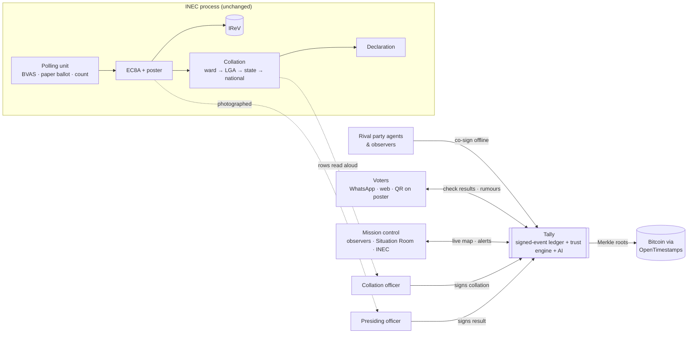

# Tally — Architecture

| | |
|---|---|
| Status | **APPROVED (Gate 2, 18 Nov 13:35 WAT)** |
| Inputs | PRD v2 (approved), threat model (PRD §9), team = 2, about 33 build hours |
| Last updated | 2026-11-18 13:25 WAT |

## 1. Drivers
The quality attributes that shape the design, in priority order:
1. **Integrity:** no one, including us, can change a recorded fact without it being detected publicly.
2. **Offline availability:** officer and agent flows must work with zero network.
3. **Reachability:** voters with any phone or language must get answers (WhatsApp first, web second).
4. **Delivery speed:** 2 people, about 33 hours. Every component must be buildable and testable inside its timebox.
5. **Operability at zero cost:** no paid services or API keys; free tiers only.

Constraints:
- the competition rules (new work only; credit everything)
- a live link is required
- the repo is public

## 2. System context (the system sketch deliverable)


## 3. Containers
```mermaid
flowchart TB
  subgraph Device["Phone (installable web app)"]
    UI[Role screens] --> KS[(IndexedDB<br/>keys · outbox · held copies)]
    UI --> SW[Service worker<br/>offline shell + cached data]
    KS -->|sync when online| API
  end
  subgraph Vercel["Vercel (one Next.js 16 deployment)"]
    API[API routes<br/>/sync /actors /places /media /verify]
    WEB[Server-rendered pages<br/>public proof · mission control]
    WH[WhatsApp webhook]
    JOBS[after() tasks<br/>anchoring · AI processing · replies]
    API --> CORE
    WEB --> CORE
    WH --> CORE
    CORE[Core library<br/>events · crypto · trust engine · reconciliation]
  end
  CORE --> DB[(Neon Postgres<br/>append-only ledger)]
  JOBS --> AIG[Vercel AI Gateway<br/>Claude vision + text]
  JOBS --> OTS[OpenTimestamps calendars]
  WH <--> META[Meta WhatsApp Cloud API]
  WEB --> TILES[OpenFreeMap tiles]
```

## 4. Architecture decisions (ADR summary). Each needs approval.
| # | Decision | Alternatives considered | Why this one | Trade-off accepted |
|---|---|---|---|---|
| A1 | **Modular monolith: one Next.js 16 app on Vercel** (UI + API + webhooks) | Separate API (Fastify/Laravel) + SPA; microservices | One deploy and one live link; the user shipped Stage 1 on this stack; zero ops | Long-running jobs limited by function duration (fine: our jobs are < 60 s) |
| A2 | **Postgres append-only ledger + hash chain + Bitcoin anchoring** | A blockchain as the database (EVM/L2); plain DB | Integrity comes from signatures + public anchoring, not consensus. Instant, free, queryable. Anchoring gives the same "can't rewrite history" guarantee | Trust in *availability* depends on our host (integrity does not) |
| A3 | **Ed25519 signatures (noble, pure JS), key generated and kept on the device** | WebCrypto Ed25519; WebAuthn/passkeys; server-held keys | Identical on old Android and on the server; audited; works offline. Server-held keys would defeat the purpose | Prototype keeps the key in IndexedDB; production moves it to a passkey/OS keystore with PIN (noted in the threat model) |
| A4 | **Installable web app (PWA) + IndexedDB outbox**, not a native app | React Native / Flutter | Judges open a link; no app-store install; one codebase; camera + QR + offline work in the mobile browser | No background sync when the app is closed (sync runs on open and on reconnect) |
| A5 | **Anchoring with OpenTimestamps**, triggered after syncs (at most every 10 min) | EVM L2 transactions; daily cron | Free, no wallet or keys, standard verifiable `.ots` proofs on Bitcoin | Bitcoin confirmation takes hours; the UI shows "submitted → confirmed" honestly |
| A6 | **AI through Vercel AI Gateway** (OIDC on Vercel, no API key). Claude vision reads EC8A; an LLM extracts rumour claims and translates replies | Direct provider SDK with a key; local OCR | No keys; provider fallback; matches Stage 1 | Local dev has no AI; it falls back to labelled manual entry |
| A7 | **AI never decides trust.** A transparent trust engine (log-odds over independent witness chains) decides | LLM judging truth | Explainable, testable, can't hallucinate a verdict; based on the user's Stage 1 design | Needs explicit evidence; defaults to "unverified" |
| A8 | **Mission control refreshes by polling (5 s)** | Server-Sent Events; WebSockets | Serverless-friendly, simple, robust on bad networks | Up to 5 s latency (within the G3 target of 10 s) |
| A9 | **Map: MapLibre GL + OpenFreeMap tiles** | Google Maps / Mapbox | Free, no key, open data | Plain base map style |
| A10 | **WhatsApp: Meta Cloud API webhook → `after()` processing → reply** | Twilio sandbox; third-party BSP | Official, free test number, gives the `forwarded` flag we need for hearsay depth | Test number reaches only 5 registered phones (enough for the demo) |
| A11 | **Languages: reviewed message templates per language; the LLM only translates the free-text claim summary (labelled)** | Full LLM translation | Verdict wording is predictable and safe in all 5 languages | Fewer phrasings |

## 5. Data model
```
places      (code PK, level, parent_code, name, lat, lng, registered)            ← INEC hierarchy (FCT seeded)
actors      (id, role, party, display_name, public_key UNIQUE, place_code, rel_alpha, rel_beta)
events      (seq PK, id UNIQUE, type, place_code, payload JSONB, occurred_at, author_id,
             content_hash UNIQUE, signature, prev_hash, ledger_hash UNIQUE, channel)   ← append-only
witnesses   (content_hash, actor_id, kind, signature, signed_at)  PK(content_hash, actor_id)
media       (sha256 PK, mime, bytes)
anchors     (id, from_seq, to_seq, merkle_root, calendars JSONB, status)
reference_2023 (pu_code PK, votes, accredited, registered, source)                  ← Replay 2023
-- to add for SHOULD items:
claims      (id, cluster_id, place_code, text, language, source_depth, channel, reporter_hash, created_at)
verdicts    (claim_cluster_id, verdict, probability, evidence JSONB, created_at)
subscriptions (phone_hash, place_code, language, channel)
```
Event types: operations (`pu.opened`, `material.*`, `staff.checked_in`) · results (`result.declared`, `transmission.attempted`, `cancellation.recorded`, `collation.entered`) · signals (`incident.reported`, `claim.reported`).

## 6. How each journey flows
| Journey | Flow |
|---|---|
| J1 Seal a result | Phone: photo → `/api/media` (hash) → `/api/ec8a/read` (AI) → officer confirms → sign locally → QR → agents verify + co-sign locally → outbox → `/api/sync` (verify signature, role, place; append under advisory lock) |
| J2 Collation | Officer app loads children + sealed totals → enters rows → signs `collation.entered` → server reconciles each row against sealed units → mismatches in the place view and the mission-control alert feed |
| J3 Was it counted? | `/p/[unit]` → best result version (trust engine) + inclusion check at every ancestor collation |
| J4 Rumour | WhatsApp webhook (verify HMAC) → `after()`: transcribe/extract the claim (AI) → cluster → evidence = ledger events for that place/time + corroborating claims → trust engine → template verdict in the user's language → reply via Cloud API |
| J5 Mission control | `/mission` polls `/api/mission` every 5 s: unit statuses + an alert feed (tamper, disputed, anomaly, rumour) |
| J6 Replay 2023 | `/mission?replay=2023` plays `reference_2023` on a timeline; the anomaly agent runs over it; labelled "historical" |

## 7. Failure modes
| Failure | Behaviour |
|---|---|
| No network at the polling unit | Everything signs locally; outbox syncs later from any device |
| AI Gateway down or slow | EC8A: manual entry (labelled). Rumours: rule-based extraction (labelled) |
| WhatsApp API down | Web "check a rumour" page offers the same engine |
| OpenTimestamps unreachable | Anchor marked failed; retried on the next sync; the ledger audit still works |
| Database unreachable | App keeps working offline; public pages show an error state, never stale data presented as live |

## 8. Quality and delivery
- **Tests:** unit tests (core: crypto, chain, Merkle, arithmetic, reconciliation, trust); an end-to-end journey script (J1/J2/J3 through the real API). Rumour engine tests to be added with J4.
- **CI (GitHub Actions):** typecheck, lint, unit tests, build on every PR, plus Postgres for the journey test.
- **Workflow:** feature branch → PR → CI green → review → squash-merge. Pushes only with the user's approval.

## 9. What already exists
Built before Gate 2 (process breach, see decision 11), tested, and **consistent with this design**:
- the core library (A2, A3, A7)
- the ledger API
- the place views
- anchoring (A5)
- the EC8A route (A6)
- 20 unit tests and the J1–J3 journey test pass

If this architecture is approved, they are **kept**. The UI is **rebuilt** after Gate 3 (UX).
